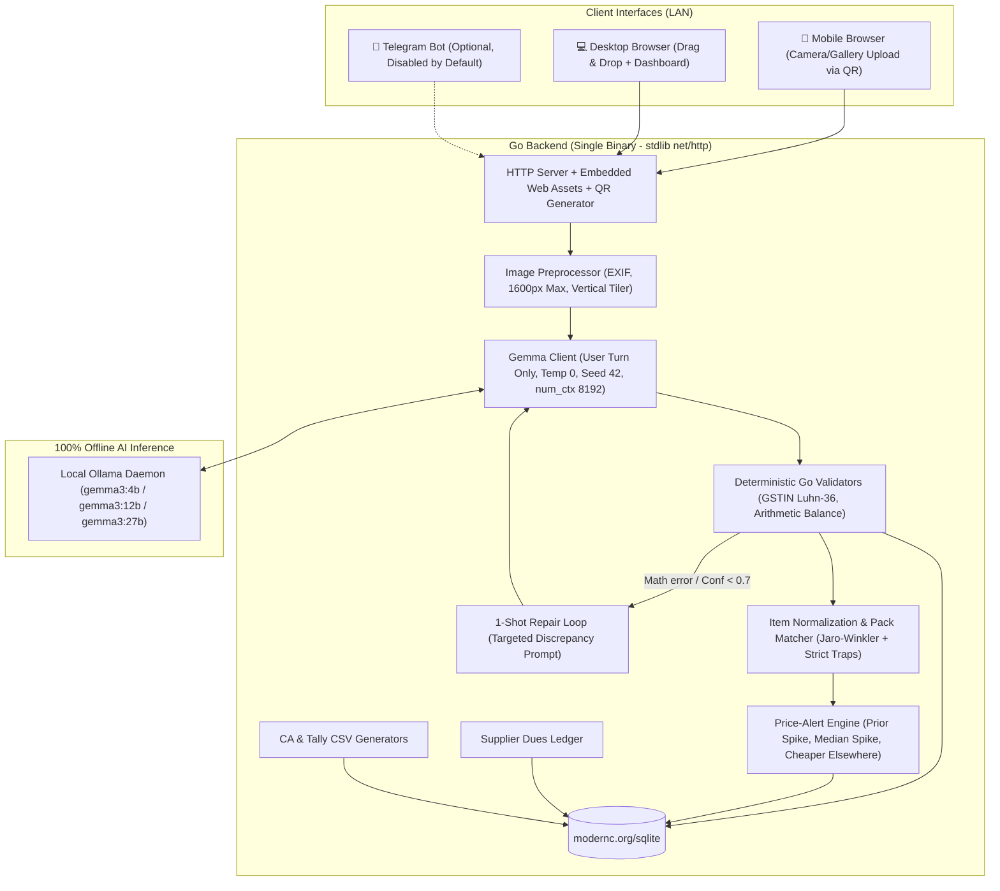

# मुनीम (Munim) — Local-First Kirana Bill Diary & Price-Alert Engine

> **Powered by Gemma, running on this computer.**
> 
> Named after the traditional Indian bookkeeper, **Munim** is a local-first bill diary and price-alert engine tailored for small Indian shop owners (kirana, pharmacy, hardware, clothing).
>
> The shopkeeper photographs supplier bills when goods arrive. Munim reads them using Google's open-weight **Gemma 3** vision model served locally via Ollama, validates the GST and arithmetic deterministically, and provides three critical business safeguards:
> 1. **Price-Change Alerts**: *"Parle-G 12-pack is 4.2% higher than on your last bill from Sharma Distributors (₹118 -> ₹123)."*
> 2. **Supplier Dues Tracker**: Running balance, credit cycles, and overdue payment alerts.
> 3. **Month-End CA & Tally Pack**: Clean CSVs ready to hand over to Chartered Accountants or import directly into Tally Prime.
>
> **Core Promise**: Supplier pricing and trade terms never leave the owner's laptop/PC. **Zero per-bill API cost.**

---

## 🚀 60-Second Quickstart

### Prerequisites
1. **Go 1.22+** installed on your machine.
2. **Ollama** installed: [ollama.ai](https://ollama.ai)
3. Pull the default Gemma vision model:
   ```bash
   ollama pull gemma3:12b
   ```
   *Alternative Gemma tags supported:*
   - `ollama pull gemma3:4b` *(fast, low-RAM laptops)*
   - `ollama pull gemma3:27b` *(high-accuracy flagship mode)*

### Run Munim
```bash
# 1. Clone repository
git clone https://github.com/GhanshyamJha05/Munim.git
cd Munim

# 2. (Optional) Generate fresh synthetic demo data
make demo-data

# 3. Build and launch (defaults to gemma3:12b)
go run ./cmd/munim

# Or override with an environment variable or flag:
# GEMMA_MODEL=gemma3:4b go run ./cmd/munim
# go run ./cmd/munim -model gemma3:27b
```

When started, Munim checks your local Ollama connection, verifies that your configured Gemma tag is pulled, binds to `0.0.0.0:8080`, detects your real local Wi-Fi LAN IPv4, and prints your desktop link and an **ASCII QR Code**:
```text
========================================================
       मुनीम (MUNIM) — Local-First Bill Diary
========================================================
 [Desktop Browser] : http://localhost:8080
 [Phone on WiFi]   : http://192.168.18.38:8080
--------------------------------------------------------
 Scan this QR Code with your phone to upload bills:
 [QR CODE]
========================================================
```

Open on your desktop browser, or scan the QR code with your phone (on the same Wi-Fi network) to take bill photos directly with your mobile camera.

---

## 🧠 Gemma 3 Integration & Engineering Details

Munim is built specifically around Google's Gemma 3 architecture:

1. **User Turn Prompting (No System Role)**:
   Gemma 3 vision models perform best when all instructions, rules, and image payloads reside inside the user turn. Munim packs all prompt instructions directly alongside the image in a single user message.
2. **Fixed-Resolution Vision & Vertical Tiling**:
   Gemma 3 downsamples vision inputs to a fixed square resolution. For tall distributor invoices (aspect ratio $> 1.6:1$), small printed items and numbers can blur. Munim automatically slices tall bills into overlapping vertical tiles ($\sim 15\%$ overlap), extracts line items from each tile, and merges & de-duplicates them using fuzzy normalization, while running a full-image pass for headers, GSTIN, and totals.
3. **Deterministic Decoding**:
   Calls are executed with `temperature: 0.0`, fixed `seed: 42`, and explicit context window `num_ctx: 8192` with Ollama's structured JSON-schema `format` parameter.
4. **Runtime Prompt Versioning**:
   - Extraction prompt: [`prompts/extract_v1.txt`](prompts/extract_v1.txt)
   - Repair prompt: [`prompts/repair_v1.txt`](prompts/repair_v1.txt)
5. **Runtime Model Switching**:
   Switch seamlessly between `gemma3:4b`, `gemma3:12b`, and `gemma3:27b` via the Web UI header dropdown, `GEMMA_MODEL` environment variable, or `-model` flag.

---

## 🏛️ System Architecture



---

## 💡 Why Gemma & Open Weights?

1. **Trade Privacy is Paramount**: In the Indian FMCG ecosystem, distributor discounts, credit terms, and cash rebates are negotiated secrets. Shop owners refuse to transmit their wholesale pricing sheets or handwritten invoices to closed cloud APIs.
2. **Zero Marginal Cost**: Kirana stores operate on thin 4–8% net margins. Paying ₹1.50–₹2.50 per invoice to cloud vision APIs costs a typical store ₹1,500–₹2,500/month. With Gemma 3 running locally on an existing shop computer, **cost per bill is exactly ₹0.00**.
3. **Hardware Scalability**:
   - `gemma3:4b`: Runs smoothly on 8GB RAM laptops and basic shop POS PCs.
   - `gemma3:12b`: Balanced speed and accuracy for standard store workstations.
   - `gemma3:27b`: Maximum character extraction precision for dense or degraded thermal receipts on high-spec systems.
4. **Tolerance for Indian Billing Realities**: Indian invoices feature Hindi, English, Hinglish, rubber stamps, faded thermal roll prints, and handwritten totals. Combining Gemma 3 with deterministic Go validators provides resilient extraction without hallucinations.

---

## 💰 Pricing & Monetization Ideas

- **Option A: One-Time Setup & Hardware Box ("Munim Box")**:
  - Sell a pre-configured mini-PC (e.g. Intel N100 / refurbished mini-PC) with Munim pre-installed and Gemma 3 offline weights pulled.
  - Price: ₹9,999 – ₹14,999 one-time. Zero recurring fees.
- **Option B: Flat Monthly Local Support**:
  - ₹299 – ₹499/month for software updates, automated WhatsApp backup to owner's private Google Drive, and phone support.
  - *No per-bill pricing ever*—aligning incentives with high invoice volume.

---

## 🔍 Evaluation & Benchmarks

Run the evaluation harness against 30 synthetic invoices with ground truth across Gemma sizes:
```bash
# Generate synthetic demo invoices with deliberate challenges
make demo-data

# Run multi-model evaluation (gemma3:4b, gemma3:12b, gemma3:27b)
make eval
```

- **[eval/RESULTS.md](eval/RESULTS.md)**: Side-by-side benchmark comparison (field accuracy, validation pass rate, price-alert precision/recall, latency, and tiling ablation).
- **[eval/failures.md](eval/failures.md)**: Failure log documenting extraction edge cases.
- **[docs/POST_NOTES.md](docs/POST_NOTES.md)**: Assembled notes for the hackathon post write-up.

---

## ⚠️ Honest Limitations

- **Hardware Requirements**: Running `gemma3:12b` locally requires at least 16GB RAM (or 8GB+ GPU VRAM). Low-spec laptops should use `gemma3:4b`.
- **Extreme Handwriting**: While typed bills and handwritten totals/stamps work reliably, completely handwritten kachha bills with non-standard abbreviations may fall into "Needs Review" for manual confirmation.
- **PDF Multi-page**: Direct PDF uploads require converting to images. Mobile camera photos (JPG/PNG) remain the primary design focus.

---

## 📜 Commands & Makefile

```bash
make run        # Build and run Munim web server
make test       # Run all table-driven unit tests
make demo-data  # Generate 30 synthetic bills and ground-truth JSON
make eval       # Run evaluation benchmark across Gemma sizes
```
